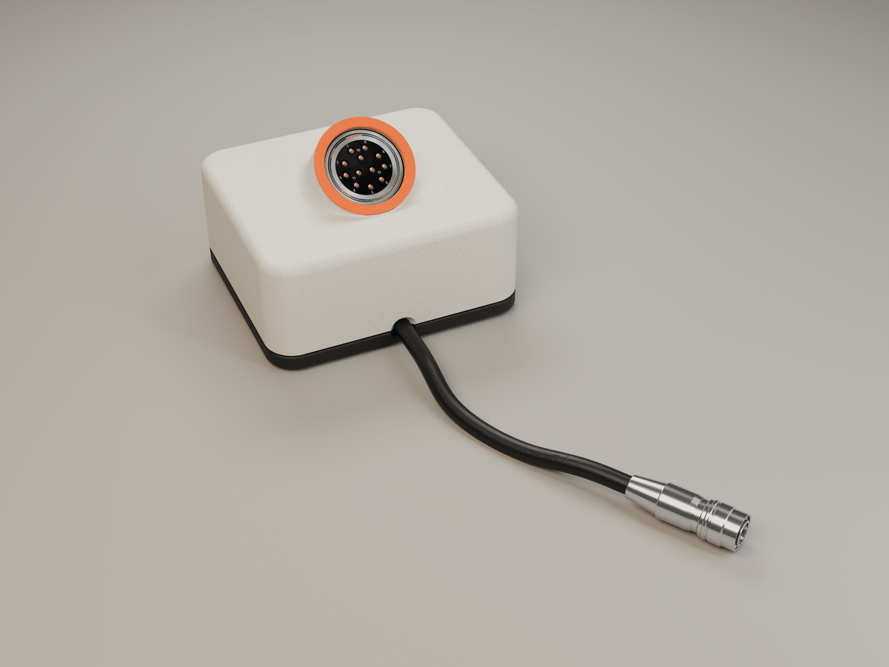
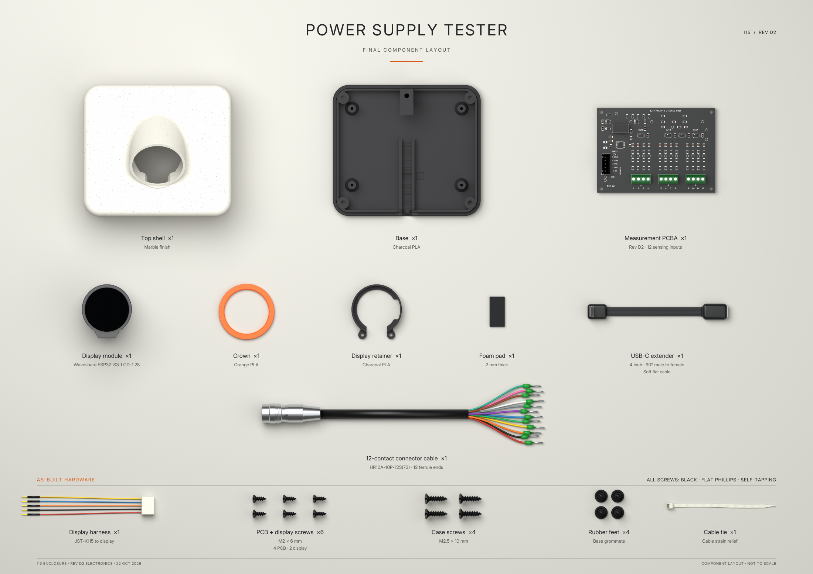
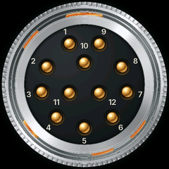
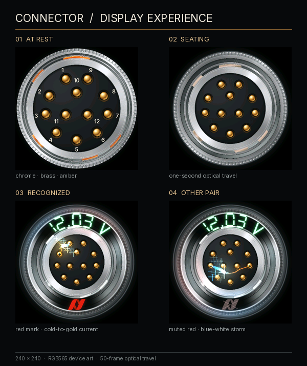

<p align="center">
  <a href="output/product-render/power-supply-tester-three-modes-6000.gif">
    
  </a>
</p>

# Power supply tester

**Twelve inputs. One supply. A little theatre on the desk.**

Rev D2 measurement PCB · I15 enclosure · ESP32-S3 · 240 × 240 round LCD

The tester identifies positive and return contacts from one common DC supply.
Chrome reflections, brass pins and orange locating keys give the idle display
its character. Applying voltage starts a one-second optical seating animation,
followed by live voltage, polarity and animated current artwork. The red Allied
Vision emblem at six o'clock currently recognizes the **1–2 pair**.

The opening render cycles through **idle → recognized pair → other powered pair**,
including the one-second optical seating transition. Download the
[6000 × 4500 still](output/product-render/power-supply-tester-hero.png) or
[6000 × 4500 animated master](output/product-render/power-supply-tester-three-modes-6000.gif).

*The animation uses illustrative voltage. The device uses its ADC readings to
drive the live display.*

## The current build

The October 23 firmware is the version the operator confirmed working: the
1–2 cable responds in approximately **1–2 seconds and stays powered**. Source,
the exact installed application binary, its display asset and build hashes are
included. [Build and flash guide →](docs/BUILD.md)

| Part of the project | Start here |
| --- | --- |
| Enclosure, ready to print | [I15 as-built 3MF and four STLs](case-cad/current/) |
| Preserved original CAD and earlier revisions | [CAD guide](case-cad/README.md) |
| Working measurement firmware | [Tester12VRevD source](firmware/Tester12VRevD/) |
| Exact working firmware + optical asset | [October 23 binary package](firmware/releases/d2-live-2026-10-23/) |
| PCB schematic, layout, BOM, Gerbers and CPL | [Rev D2 hardware](hardware/rev-d/README.md) |
| Finished product rendering and animation | [6K still](output/product-render/power-supply-tester-hero.png) · [6K GIF](output/product-render/power-supply-tester-three-modes-6000.gif) · [scene and regeneration guide](output/product-render/README.md) |
| Assembly poster | [A2 PDF](output/pdf/power-supply-tester-final-layout.pdf) · [full-resolution PNG](output/final-layout-poster/power-supply-tester-final-layout.png) |
| Poster scene and parts list | [Blender scene](output/final-layout-poster/final-layout.blend) · [parts manifest](output/final-layout-poster/parts-manifest.json) |
| Artwork sources and generation | [Scripts](scripts/) · [art and build guide](docs/BUILD.md#artwork-and-poster) |
| Calibration and bench testing | [Local calibration UI](tools/calibration-ui/README.txt) · [firmware/calibration guide](firmware/Tester12VRevD/README.md) |
| Timing, installation and regression evidence | [October 23 record](output/fast-response-2026-10-23/flash-evidence.json) |

## The assembly



| Hardware | Quantity | Use |
| --- | ---: | --- |
| M2 × 6 mm, black flat Phillips self-tapping screws | 6 | Four for the PCB, two for the display |
| M2.5 × 10 mm, black flat Phillips self-tapping screws | 4 | Case |
| 2 mm foam pad | 1 | USB support |
| 4-inch soft flat USB-C extension, 90° male to female | 1 | Internal USB connection |
| Twelve-core HR10A connector cable with ferrule ends | 1 | Twelve sensing inputs |
| Five-wire display harness | 1 | Display-to-PCB connection |
| Rubber feet | 4 | Base |
| Cable tie | 1 | Cable strain relief |

The [as-built print plate](case-cad/current/PSU_case_I15_as_built.3mf) contains
the base, shell, crown and display retainer. The preserved original I15 package
also contains the earlier printed shim; the current assembly uses the foam pad.
The poster shows the display as unpowered black glass and the USB cable straight.

Selected components: [screw assortment](https://www.amazon.com/dp/B0G24Z3P66),
[USB extension](https://www.amazon.com/dp/B0D9XGFW3W).

## Display art

<p align="center">
  
</p>



- **Idle:** numbered brass contacts and orange orientation sheen.
- **Seating:** optical travel across one second.
- **Recognized pair:** static red emblem, cold-to-gold discharge and a spectral helix.
- **Other pairs:** muted crossed emblem with live polarity effects.

The previews show the visual design. The firmware samples 21 travel frames
across the one-second transition; playback and render timing are recorded in
the device logs. The electrical overlays illustrate classified polarity.

## Electronics and validation

The non-touch Waveshare ESP32-S3-LCD-1.28 handles the display and measurement
firmware. Four ADS1115 devices on the isolated measurement PCB provide twelve
sensing channels and a reference channel. See the
[hardware guide](hardware/rev-d/README.md) for the supported connection model,
limits, pin numbering and harness wiring.

The current prototype uses the measured input-1 gain shared with inputs 2–12,
with copied calibration provenance retained. Complete individual-channel
calibration and independent accuracy qualification remain in the
[calibration guide](firmware/Tester12VRevD/README.md). Noisy batches can produce
a filtered provisional LCD estimate while the strict measurement CSV rejects
them. The display response improvement preserves that distinction.

## Build and test

```sh
python3 -m venv .venv
source .venv/bin/activate
python -m pip install -r requirements.txt

clang++ -std=c++17 -O2 hardware/rev-d/scripts/test_preview_detection.cpp -o /tmp/tester-preview
/tmp/tester-preview
python hardware/rev-d/scripts/test_integration.py
python hardware/rev-d/scripts/test_calibration_commands.py
```

These tests use simulated hardware and do not open the tester's USB port.
Firmware compilation, binary recovery, artwork generation and poster rendering
are documented in [BUILD.md](docs/BUILD.md).

## Project map

```text
case-cad/        Current printable enclosure and historical CAD/reference exports
firmware/        Measurement source, display demos and the working binary package
hardware/        KiCad sources, manufacturing exports, sourcing and validation
scripts/         Artwork, optical assets, enclosure export and poster generation
tools/           Local calibration and supply-test interface
assets/          Fonts and their license/source records
docs/            Build guide and README artwork
output/          Posters, display assets and engineering/test evidence
references/      Manufacturer drawings and reference material
```

Historical hardware packages and art studies are retained with their revision
names. The links in **The current build** identify this prototype's baseline.
Third-party fonts, code, logos and models retain their original terms; see
[third-party notices](THIRD_PARTY_NOTICES.md).
