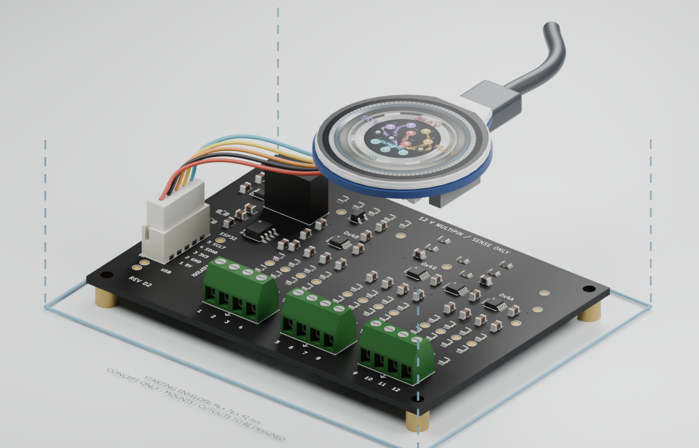
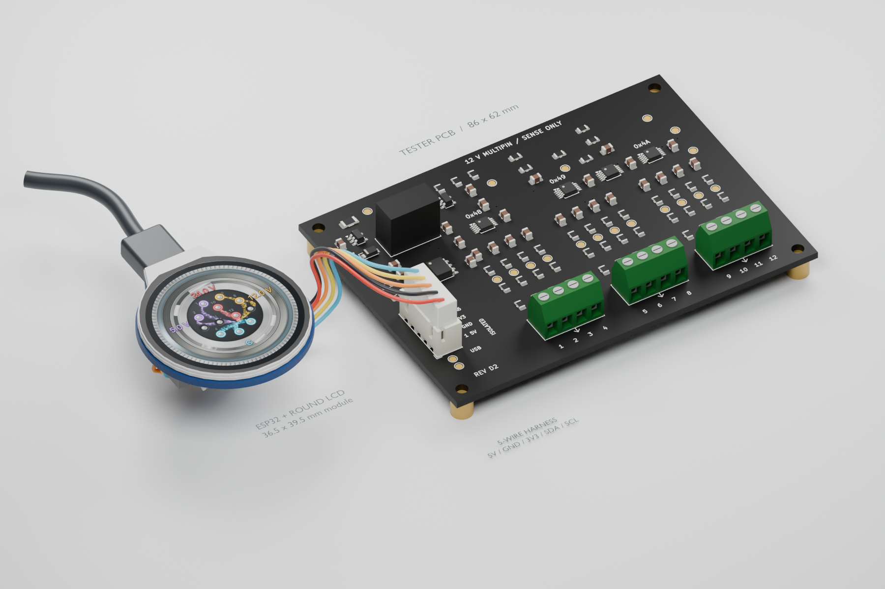
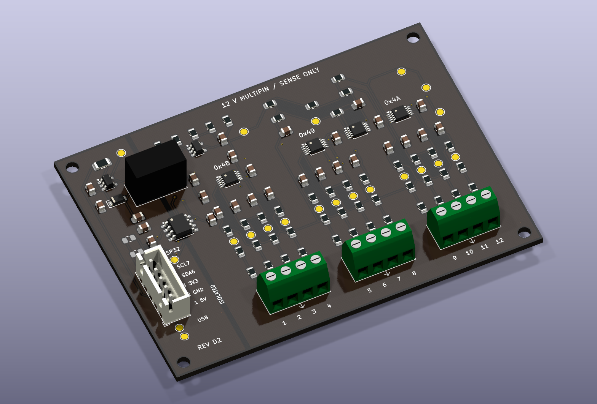

# Power supply tester

Hardware, firmware, enclosure designs, and display artwork for a twelve-input DC power supply tester with a round Waveshare ESP32-S3 display.

The designated engineering baseline is **Rev D2**, as recorded in [hardware/LATEST-DESIGN.txt](hardware/LATEST-DESIGN.txt). It identifies multiple positive and return pins from one common DC supply. Read the [Rev D2 design guide](hardware/rev-d/README.md) for supported connections, operating limits, wiring, and calibration requirements. Physical prototype testing and manufacturing placement/DFM review remain outstanding.

## Renderings

**Display, connector, and wiring**

The round Waveshare display connects to the measurement PCB through the proposed five-wire harness. USB power enters at the display module.

**Board and display assembly**

**Rev D2 PCB**

The assembly views combine the Rev D2 board geometry with the display model. Harness routing, enclosure placement, and on-screen readings are illustrative; see the [assembly guide](output/enclosure-d2/assembly-guide.txt) for dimensions and wiring details.

## Start here

- [Hardware and wiring](hardware/rev-d/README.md)
- [Matching Rev D firmware](firmware/Tester12VRevD/README.md)
- [Validation record](hardware/rev-d/validation/REPORT.md)
- [Complete Rev D2 engineering package](hardware/tester12v-rev-d2-engineering-package.zip)
- [Connector artwork](output/README.md)

## Workspace layout

| Directory | Contents |
| --- | --- |
| `hardware/` | KiCad sources, PCB revisions, manufacturing exports, sourcing, and validation evidence |
| `firmware/` | ESP32 measurement firmware and earlier display demonstrations |
| `scripts/` | Connector artwork, animation, rendering, and device utilities |
| `output/` | Display assets, previews, and enclosure designs |
| `outputs/` | BOM review workbooks and supporting artifacts |
| `references/` | Manufacturer drawings and reference models |

Earlier revisions and Rev E development material are retained alongside the designated baseline. Use the matching hardware, firmware, and manufacturing files together; the revision guides describe their compatibility.

Local tool environments, caches, editor backups, and intermediate animation frames are excluded from version control. Build and regeneration instructions live with the relevant firmware, hardware revision, or artwork. Manufacturer reference material and bundled third-party code retain their original terms and notices.
