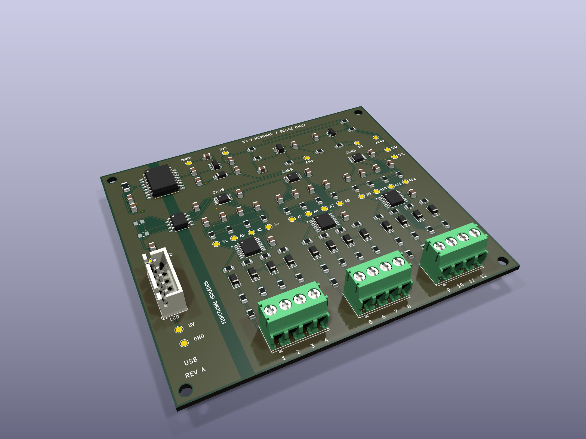

# 12 V pin-voltage tester — Rev A prototype

This is an actual KiCad 9 schematic and routed PCB, designed for a nominal **12 V DC source on any two of twelve inputs**, in either polarity. The other inputs are normally open. It measures voltage; it does not supply 12 V, switch power between connector pins, perform a load test, or prove which wire is earth/chassis ground.

**Status: prototype fabrication package with completed computer checks. No assembled Rev A board has been bench tested.** Component substitutions, assembled-board accuracy, power sequencing, and the display harness still require the first-article checks below. Do not interpret the simulations as a guarantee of operation.

The copper, holes, placements, and board outline in this render come from `tester12v.kicad_pcb`. Standard library component bodies are representative; the RECOM converter uses a generic SOIC body with a similar outline. This is not the earlier generated concept image. The **Waveshare ESP32-S3-LCD-1.28 non-touch** round display/controller connects by a five-wire harness and mounts separately. Display mounting holes or an enclosure are not part of this PCB.

## Files to use

- `../tester12v-rev-a-jlc-order.zip`: concise order handoff. Extract it, then upload `PCB-Gerbers.zip`, `BOM.csv` and `CPL.csv` to their respective JLC steps. Read `ORDER-INSTRUCTIONS.txt` first; U7 sourcing remains unresolved. This bundle contains the primary optimized BOM only.
- `tester12v.kicad_pro`, `tester12v.kicad_sch`, `bank1..3.kicad_sch`, `tester12v.kicad_pcb`: editable native design.
- `previews/schematic.pdf`, `previews/assembly.pdf`: circuit and component-location drawings.
- `previews/tester12v.step`: board/component geometry for mechanical review, subject to the model limitation above.
- `manufacturing/tester12v-rev-a-fabrication.zip`: Gerber and drill package for bare PCBs.
- `manufacturing/bom-grouped.csv`, `manufacturing/placements-smd.csv`: component purchasing/assembly information. R43 and R44 are **DNP**. J1–J4 are through-hole parts, omitted from the SMD placement file.
- `manufacturing/jlc-bom.csv`, `manufacturing/jlc-cpl.csv`: JLC upload files with exact library codes and all 114 fitted components, including J1–J4. See the sourcing blocker below before releasing an order.
- `sourcing/JLC-BOM-review.xlsx`, `sourcing/jlc-review.json`: dated price, stock, substitution and fee comparison.
- `validation/REPORT.md`: methods, results, assumptions, and limits of the checks.
- `../../firmware/Tester12V/`: live measurement firmware. The older `ConnectorDisplay` sketch is still the simulated animation demo.

## JLC sourcing update — 2026-09-30

The BOM now uses 24 exact JLC part numbers: eight Basic and sixteen Extended. Twenty-three part types had sufficient displayed stock for the nominal two-board quantity. **U7, RECOM R05C05TE05S-R / C5338283, had zero stock and requires preorder; no lead time was displayed.** Obtain its confirmed delivery and price before releasing the assembly order. This update does not make the whole assembly immediately available.

Four ordinary resistor types and four capacitor types now use Basic parts. This avoids eight Economic PCBA loading fees, approximately **$24.56 per order** at JLC's published $3.07 rate. It is a fee saving, not a claim that the entire order is $24.56 cheaper: the stocked switch packaging costs more than its preorder-only alternative. Standard PCBA charges loading for Basic parts too, so the same saving does not apply there. [JLC assembly fee schedule](https://jlcpcb.com/help/article/pcb-assembly-price).

The 165 kΩ, 10 kΩ and 100 kΩ precision resistors remain the original Yageo 0.1%, 25 ppm/K parts. C1–C12/C28 change from an unavailable Murata part (preorder minimum 799) to stocked Yageo C62774, preserving 1 nF, 5%, 50 V and C0G/NP0. All other capacitor substitutions preserve nominal capacitance, tolerance and dielectric, with equal or higher voltage ratings. C24's Samsung C45783 is NRND but had over four million pieces in JLC stock; it is selected for this small prototype order, with a fresh lifecycle review required for ongoing production. MLCC effective capacitance and startup/shutdown behavior still require bench verification.

U4–U6 use stocked **ADG4612BRUZ-REEL7 / C207399**, the same TSSOP-16 chip with different shipping packaging. JLC displayed 41 pieces and $6.7450 each. The optional `manufacturing/jlc-bom-preorder-switches.csv` selects the original **ADG4612BRUZ / C657391** instead: zero stock, estimated nine-day lead time, MOQ four and estimated $2.7916 each. Six fitted switches could cost about $23.72 less, before attrition; consider this only if its confirmed lead time fits the converter wait. Use one BOM, not both.

At displayed 1+ unit prices, the primary BOM's nominal fitted parts for two boards total **$93.16**, including a **$20.97 unconfirmed converter preorder estimate**. The Economic loading allowance is another $49.12. These are not a checkout quote: PCB fabrication, setup, placement, attrition/spares, minimum-order overhead, shipping, tax, LCD module and harness are excluded. Nothing is reserved or ordered.

The JLC CPL uses the same origin as the Gerbers: X right, Y upward, millimetres; negative Y is intentional. J1–J4 use the centre of the footprint's F.Fab body rather than the pin-1 origin. SMD positions and rotations are unchanged. Inspect JLC's placement preview against `previews/assembly.pdf`, especially polarized parts and connector orientation; JLC library rotation conventions have not been validated in an order. Resolve converter sourcing, part matching and manufacturer DFM before payment. The populated count is 114; R43/R44 and test pads are excluded.

Sourcing changed only MPN/manufacturer/library metadata. The native PCB now also contains the optimized purchasing fields. All circuit values, pin nets, footprint geometry and routing are unchanged. Gerbers, drills, DNP-filtered stencil, placements, schematic and assembly PDFs have been regenerated. Exact drawing commands match the prior release after excluding export timestamps. ERC/DRC and the 356-pad connectivity audit pass; DC/transient and host firmware tests passed for the same unchanged circuit. No assembled-board tests have been performed.

## Board and electrical specification

| Item | Rev A |
|---|---|
| Board | 90 × 80 mm; two copper layers; 1.6 mm FR-4; 1 oz copper |
| Minimum routed trace / clearance | 0.20 mm / 0.20 mm netclass clearance |
| Through vias | 0.60 mm diameter / 0.30 mm finished drill |
| Mounting | Four 2.7 mm non-plated holes; centers (3,3), (87,3), (3,77), (87,77) mm |
| Inputs | Twelve high-impedance sense terminals; three four-position 3.5 mm screw terminals |
| Normal input range | 0–18 V DC between the active pair; optimized for 12 V |
| Fault target | 48 V DC differential miswire survival target, **not a qualified rating or accurate measurement range** |
| Power | Separate USB-domain 5 V and 3.3 V through J4 |
| Isolation | Isolated DC/DC plus I²C isolator; no copper crosses the 2.7 mm isolation corridor |
| ADCs | Three ADS1115, addresses 0x48, 0x49, 0x4A; ±4.096 V ADC scale; 3.3 V supply |
| Display | Existing Waveshare ESP32-S3-LCD-1.28, 240 × 240 GC9A01 |
| Accuracy | ±0.15 V around 12 V after calibration is a **bench acceptance target**, not a measured specification |
| Environment | Initial qualification at room temperature, clean/dry PCB, low-energy DC supplies |

The isolated ground floats with the connected supply. A displayed negative terminal is the lower-voltage terminal of the detected pair, not an earth-ground identification. Multiple rails and multiple connected returns can be ambiguous; the firmware rejects patterns that do not fit one live pair. This board is not a mains, CAT-rated, or automotive transient instrument. It is not a continuity tester for unpowered wires.

## Circuit operation

Each input passes through two 165 kΩ resistors. A 12 V Zener limits the source-side voltage of an ADG4612 switch; a 100 kΩ source bleed defines its voltage during startup. The switch connects to a 10 kΩ bias resistor, a 1 nF filter, and one ADC input. All three precision resistor values use 0.1% parts. The 100 kΩ bleed prevents the protection switch from staying in overvoltage isolation when a 12 V source is attached before USB power.

An OPA320 buffers half the isolated 3.3 V rail. R39 is a 220 Ω bleed that also discharges the bias node when power is removed. The TLV809EA30 supervisor enables the switches after the analog supply is established and disables them as the rail falls. D13 provides the TLV75533 regulator's output-to-input reverse-current path. Do not substitute the earlier MCP6001/1 kΩ/100 nF trial values.

The nominal differential scale, neglecting switch resistance and ADC loading, is:

`Vpair = (1 + 330k/10k + 330k/100k) × (VADC+ − VADC−) = 37.3 × ΔVADC`

An open ADC channel is approximately 1.50 V. At 12 V, the selected pair is approximately 1.34 V and 1.66 V. Firmware uses all twelve measurements to find the pair and its polarity. ADC loading, component tolerance, leakage, and different ADC gain errors require calibration for accurate readings. Scans are sequential, not a simultaneous oscilloscope capture.

## Display harness and power

Use the PCB connector's **pin numbers**, confirmed against the assembly drawing; do not infer wire order from a photograph. J4 is a JST XH five-position header. The mating housing is XHP-5 with appropriate XH contacts and insulated wire.

| J4 pin | PCB net | Existing Waveshare header connection |
|---|---|---|
| 1 | USB5V | Regulated USB-domain 5 V; H2 pin 3 VSYS is conditional as described below |
| 2 | USB_GND | H2 pin 1 GND |
| 3 | HOST3V3 | H2 pin 4, 3V3 |
| 4 | SDA_HOST | H2 pin 5, GPIO6 |
| 5 | SCL_HOST | H2 pin 7, GPIO7 |

The Waveshare schematic puts a Schottky diode between USB VBUS and VSYS. **Verify at least 4.5 V at U7's input after F1 while running**, and no more than 5.5 V. VSYS from a weak cable or low USB supply may not meet that minimum. If needed, feed J4 pin 1 from a regulated 5 V USB breakout/supply, sharing only the USB-domain ground. Do not connect an external 5 V source to the display's VSYS while also driving it from USB without reviewing that supply arrangement. Battery-only display operation does not provide the required tester supply.

R43/R44 stay unpopulated because the Waveshare module already has 4.7 kΩ I²C pull-ups on GPIO6/7. The isolated side has its own pull-ups. Use a short harness, initially no more than about 15 cm, and 100 kHz I²C. Never connect a DUT wire to J4 or bridge AGND to USB_GND during normal operation.

## First-article bench procedure

1. Inspect IC orientation, all diode cathodes, resistor values, solder bridges, and the 12 input paths against the assembly PDF. Confirm R43/R44 are absent. Clean flux before measuring leakage or calibrating.
2. With no DUT connected, check for supply shorts and for an unintended DC connection between USB_GND and AGND. Use an ordinary continuity/resistance test; do not apply a high-voltage insulation tester to the assembled board.
3. Power through J4 from a current-limited 5 V supply, initially limiting the tester's 5 V feed to 100 mA. Supply HOST3V3 from the display/controller. Check U7 input ≥4.5 V, isolated output near 5 V, A3V3 near 3.3 V, VBIAS near 1.65 V, and EN near 3.3 V after the supervisor delay. Investigate a sustained tester 5 V current above 100 mA. Measure actual consumption; the current budget is not a bench result.
4. Load the `Tester12V` sketch using the existing project flashing method. Its serial console runs at 115200 baud. Check all three ADC addresses and all twelve ADC readings near 1.50 V. Confirm unplugging the measurement board produces `ADC FAULT`, not a retained voltage.
5. Use an **isolated, current-limited** 12 V source, initially limited to 10 mA, between terminals 1 and 2. Check both polarities. The device draws only tens of microamps from this source; it does not load-test it.
6. Run all 132 ordered positive/negative pin pairs using `validation/bench-pairs.csv`. Record displayed pair, polarity, voltage, and the reference DMM reading. Calibrate before evaluating the ±0.15 V target. Also test no source, shorted pair, and an intentionally ambiguous multi-wire connection.
7. Check 3.3, 5, 9, 12, 15, and 18 V with representative pairs within one ADC and across different ADCs. Check settled accuracy, rise/fall response, and noise over at least 60 seconds.
8. Repeat power cycles with the 12 V DUT attached first, USB attached first, and removal/reconnection of each. Observe A3V3, VBIAS, EN, and representative ADC nodes with an isolated/differential probe. A grounded oscilloscope lead must not inadvertently bridge the isolation boundary. Check ADC nodes stay between AGND −0.3 V and A3V3 +0.3 V, and verify no persistent back-powering.
9. Only after the normal tests pass, evaluate the 24/48 V DC miswire target with a current-limited source, monitoring internal nodes and supply current. Do not claim a 48 V rating from the computer model alone. ESD, EMC, thermal extremes, and fast transients require separate qualification.

Record measured results and any board changes before ordering a larger batch.

## Calibration

Calibrate every channel with two known input voltages referred to **AGND on the isolated side**, using a floating precision source and DMM. This is a bench calibration arrangement, not the normal floating-pair connection. Do not connect the calibrator's return to USB_GND.

For each input, record the raw ADC voltage from serial CSV at a measured 0 V and a measured approximately +12 V on that terminal. Keep all other input terminals open. Average at least 32 settled readings per point. Calculate:

`gain = (Vhigh − Vlow) / (ADChigh − ADClow)`

`offset = Vlow − gain × ADClow`

Send `cal <pin 1..12> <gain> <offset>` over the serial console. Values persist in the ESP32's nonvolatile storage. For example, a measured gain near 37.3 is expected; the offset is often a large negative value because of the internal bias. **Use measured values, not this nominal example.** Complete all twelve channels; the firmware shows `FINISH CAL` while calibration is partial. `defaults` clears calibration and restores the nominal uncalibrated scale. Then disconnect the AGND calibration return and repeat floating-pair tests, including reversed polarity and cross-ADC pairs.

## Design sources

Pin assignments, ratings, and footprints were checked against the manufacturers' documents: [ADS1115](https://www.ti.com/lit/ds/symlink/ads1115.pdf), [ADG4612](https://www.analog.com/media/en/technical-documentation/data-sheets/adg4612_4613.pdf), [ISO1640B](https://www.ti.com/lit/ds/symlink/iso1640.pdf), [RECOM converter](https://recom-power.com/pdf/Econoline/RxxC05TExxS.pdf), [TLV755P](https://www.ti.com/lit/ds/symlink/tlv755p.pdf), [TLV809E family](https://www.ti.com/lit/ds/symlink/tlv803e.pdf), [OPA320](https://www.ti.com/lit/ds/symlink/opa320.pdf), [BZT52H](https://assets.nexperia.com/documents/data-sheet/BZT52H_SER.pdf), [PMEG2010ER](https://assets.nexperia.com/documents/data-sheet/PMEG2010ER.pdf), [Phoenix 1984633 terminal](https://www.phoenixcontact.com/en-us/products/printed-circuit-board-terminal-pt-15-4-35-h-1984633), and [Waveshare documentation](https://docs.waveshare.com/ESP32-S3-LCD-1.28).

Available PDF snapshots and source URLs are in `sources/`. Some manufacturer downloads were blocked; their documents were reviewed through the browser instead. Parts have not been reserved and stock, price, fabrication lead time, and assembler substitutions have not been confirmed.

The native PCB is the authoritative finished copper layout. `scripts/build_kicad.py` recreates **unrouted placement** and overwrites the PCB; run it only in a separate working copy. The routing scripts record the construction steps and are not a one-command regeneration of the finished release.
